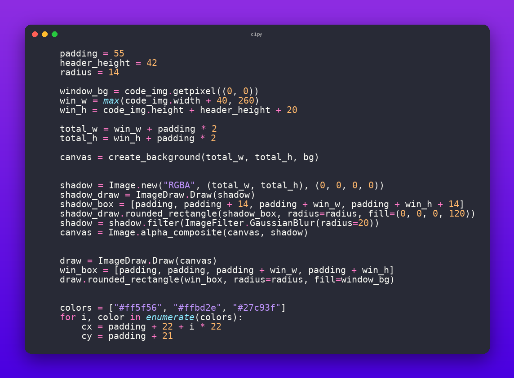

# snipc


A fast, zero-browser CLI tool to turn your code snippets into aesthetic images straight from your terminal.



## Features
- **500+ Languages** — automatic syntax highlighting powered by Pygments.
- **Built-in Gradients & Custom Colors** — choose from `ocean`, `sunset`, `emerald`, `cyberpunk`, `peach`, `midnight`, or pass any HEX color.
- **Line Slicing** — capture only the relevant lines of a file (`--lines 10:25`).
- **Clipboard Support** — copy generated images directly to your clipboard (`--copy`) on Linux (Wayland/X11), macOS, and Windows.
- **macOS-style Window Frame** — soft drop shadows and auto-detected file title in the header.

## Installation

Recommended via `pipx` or `uv`:

```bash
pipx install snipc
```

Or using standard `pip`:

```bash
pip install snipc
```


> **Note for Linux users:** To use the `--copy` flag, make sure you have `wl-clipboard` (Wayland) or `xclip` (X11) installed.

## Usage

Generate a snippet card with default settings (`snippet.png`):
```bash
snipc main.py
```

Customize theme, gradient background, line range, and copy directly to clipboard without saving a file:
```bash
snipc src/app.py --theme monokai --bg sunset --lines 15:40 --copy
```

Save to a specific path with line numbers and a custom system font:
```bash
snipc main.cpp -o card.png -n -f "JetBrains Mono"
```

List all available syntax themes and gradients:
```bash
snipc --list-themes
```

## Options

| Option | Short | Description | Default |
| :--- | :---: | :--- | :--- |
| `--out` | `-o` | Output PNG file path | `snippet.png` |
| `--theme` | `-t` | Syntax highlighting theme | `dracula` |
| `--bg` | | HEX color or built-in gradient name | `cyberpunk` |
| `--lines` | `-l` | Line range to capture (e.g., `1:25`) | All lines |
| `--numbers` | `-n` | Show line numbers | `False` |
| `--no-title` | | Hide filename in the window header | `False` |
| `--copy` | `-c` | Copy image directly to clipboard | `False` |
| `--font` | `-f` | Custom system font family name | System default |
| `--list-themes` | | Show all available themes and gradients | |

## License

MIT
